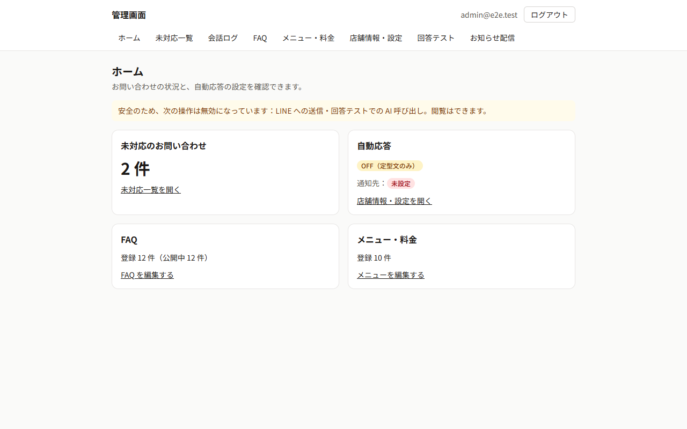
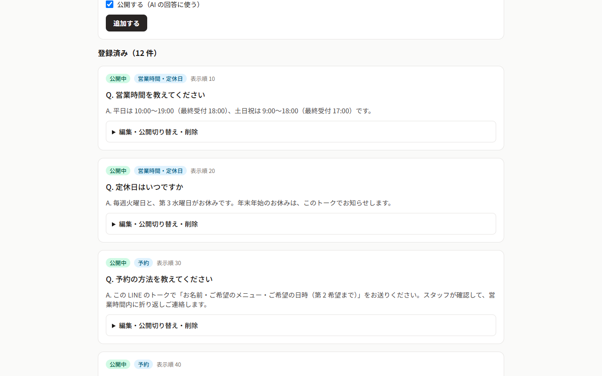
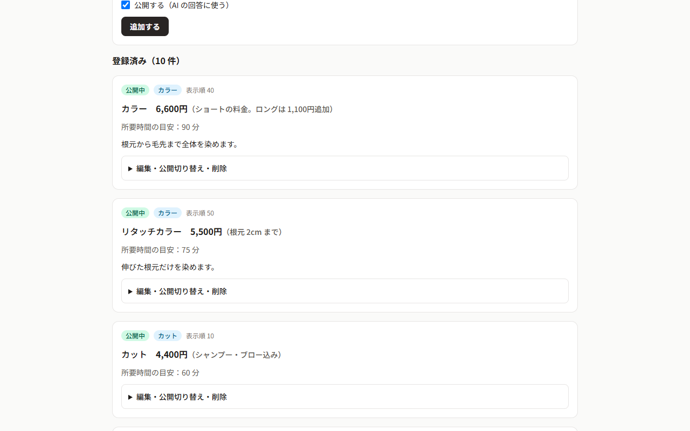
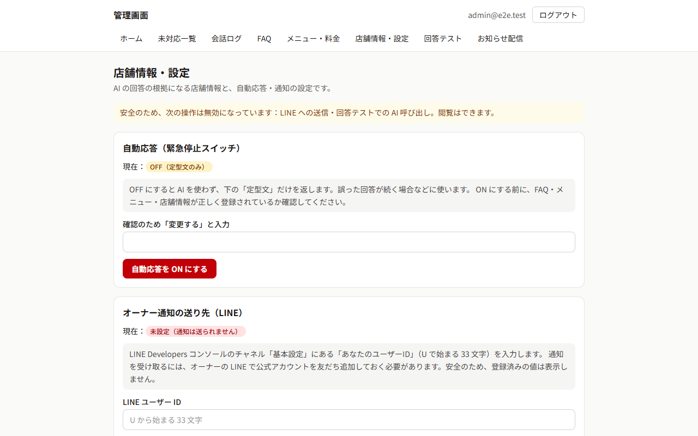
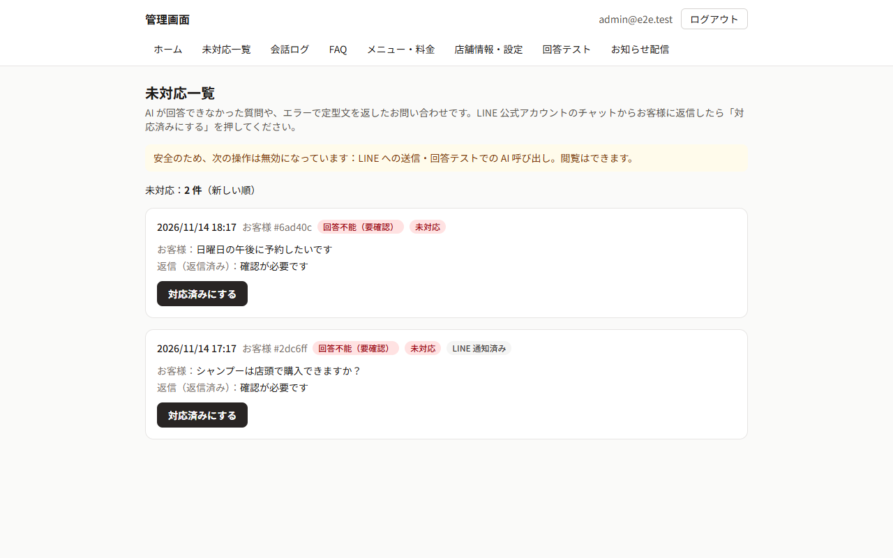
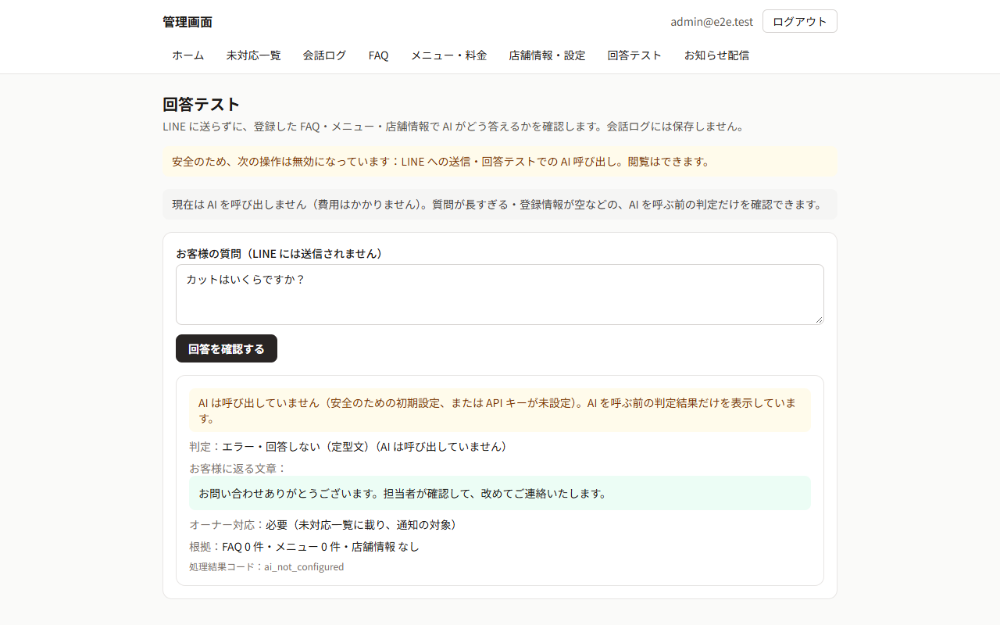
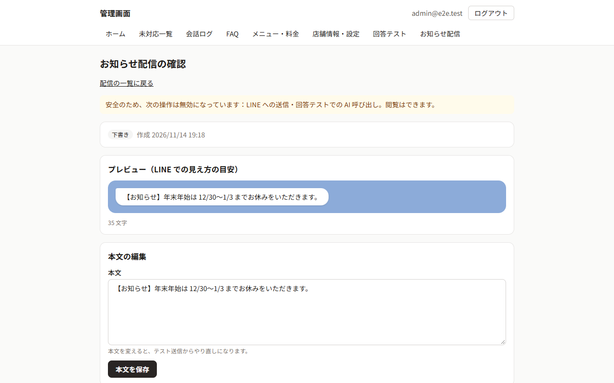
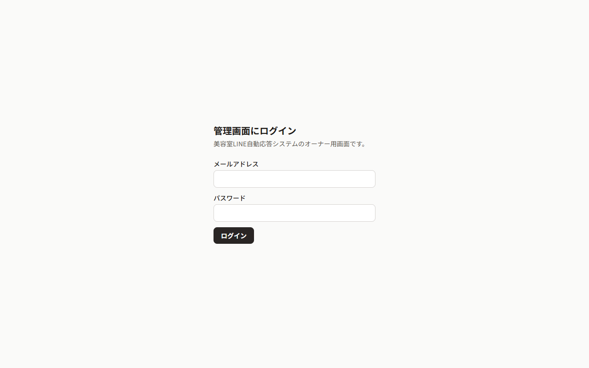
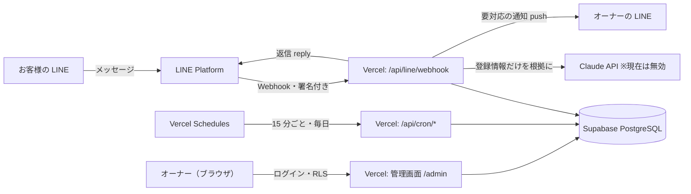

# 美容室向け LINE bot＋AI 自動応答システム

LINE 公式アカウントへのお客様の問い合わせに、店舗が登録した FAQ・メニュー料金・店舗情報**だけ**を根拠に AI が回答し、答えられない質問はオーナーの LINE に通知するシステムです。オーナーは管理画面から FAQ・料金の更新と、お知らせの一斉配信を行えます。

> **学習用の作品です。** AI 開発講座 初級編の模擬受託案件として制作しました（2026-11-10〜11-14）。登録しているのは**架空の店舗**「ヘアサロン こもれびの森」のデータで、実際の店舗では運用していません。
> **AI（Claude API）は実接続テスト済み・現在は無効です。** 2026-11-14 に、管理画面の「回答テスト」から実際の Claude API を呼び出し、主要 5 問（営業時間・料金・予約・施術・駐車場）がすべて期待どおりに回答することを確認しました。テスト後は API キーを削除しているため、現在の本番では AI は呼ばれません。**LINE 経由の AI 自動返信は未検証**です。

- 公開 URL（管理画面）：https://salon-line-bot-nine.vercel.app （ログインには管理者アカウントが必要です。新規登録は無効）
- 現在の本番の設定：**自動応答 OFF・LINE への返信は dry-run（送信しない）・管理画面の書き込みは無効**（安全のための設定）

## 画面

| ホーム | FAQ | メニュー・料金 |
|---|---|---|
|  |  |  |
| **店舗情報・設定** | **未対応一覧** | **回答テスト（AI を呼ばない設定）** |
|  |  |  |
| **お知らせ配信** | **ログイン** | |
|  |  | |

画面はローカルの偽の DB（ブラウザ自動テストと同じ仕組み）で、架空店舗のデータを使って撮影しました（`e2e/screenshots.spec.ts`）。本番のデータ・個人情報は写っていません。

## 主な機能

**LINE の自動応答**

- 署名の検証（改ざん・なりすましの拒否）と、同じイベントの二重処理の防止（`webhookEventId`）
- 登録情報（FAQ・メニュー・店舗情報）だけを根拠に回答。回答はコードで検査し、**登録外の金額・電話番号・URL、空き状況や予約可否の断定**を含むものは「確認が必要です」に差し替えてオーナーに通知
- 予約の問い合わせには、AI の文章を使わず、登録した予約方法の案内をコードで組み立てて返す
- 画像・スタンプには定型文。自動応答の緊急停止（OFF で AI を使わず定型文だけ）
- AI の利用回数の上限（1 人 10 分 5 回・1 日 30 回、店舗 1 日 300 回）

**オーナー通知**：答えられなかった質問・エラーを、オーナーの LINE にまとめて通知（10 分間隔・1 日 5 通まで。再送キーで二重送信を防止）。15 分ごとの定期実行でも送る

**管理画面**：ログイン（Supabase Auth）／FAQ・メニュー料金・店舗情報の編集／会話ログ・未対応一覧／回答テスト／お知らせの一斉配信（テスト送信必須・送信可能数の確認・確認文言の入力・二重送信の防止）

**保守**：保持期間を過ぎたデータの定期削除（会話 90 日・Webhook の記録 7 日 など）、本番 DB の権限・設定を確認する SQL（`scripts/supabase/verify.sql`・136 項目）

## 使用技術

| 分類 | 技術 |
|---|---|
| アプリ | Next.js 16（App Router・Cache Components）、TypeScript、Tailwind CSS v4 |
| DB・認証 | Supabase（PostgreSQL・Auth・RLS）。スキーマは `supabase/migrations/` の 8 本 |
| 外部サービス | LINE Messaging API、Claude API（`@anthropic-ai/sdk`。実接続テスト済み・現在は API キーを削除して無効） |
| ホスティング | Vercel（Hobby・関数は東京リージョン・定期実行は Vercel Schedules） |
| テスト | Vitest（単体）、PGlite（ローカルの PostgreSQL で DB 関数・権限を検証）、Playwright（Microsoft Edge でブラウザ自動テスト） |

## 構成



詳しくは [docs/architecture.md](docs/architecture.md)（データの流れ・DB 設計・プロンプト設計・誤回答／誤送信の対策）。

## セットアップ（ローカル）

前提：Node.js 24（`package.json` の `engines`）、npm。

```bash
npm install
cp .env.example .env.local   # Windows の PowerShell では Copy-Item .env.example .env.local
npm run dev                  # http://localhost:3000
```

- `.env.local` の値は空のままでも起動できます。LINE の Webhook は署名を検証できないため受け付けず、管理画面は Supabase の接続情報がないとログインできません
- **本番に接続せずに画面を動かして確かめる**には、ブラウザ自動テスト（下記）を使います。偽の DB（PGlite）と偽の認証で、管理画面のすべての操作を試せます
- Supabase のプロジェクトへのマイグレーションの適用は [docs/supabase-setup.md](docs/supabase-setup.md)、Vercel へのデプロイ（環境変数・LINE の Webhook URL・定期実行）は [docs/deployment.md](docs/deployment.md)
- 秘密の値（LINE のトークン・Supabase の secret key・Claude の API キー）は `.env.local`（Git 管理外）か Vercel の環境変数にだけ置きます

## テスト

```bash
npm run test        # 単体テスト（外部 API はすべてモック。DB は PGlite に全マイグレーションを適用）
npm run test:e2e    # ブラウザ自動テスト（偽の Supabase に接続。本番・LINE・Claude には接続しない）
npm run lint
npm run typecheck
npm run build
```

| テスト | 結果（2026-11-14 時点） |
|---|---|
| 単体テスト | 51 ファイル・989 件すべて合格 |
| ブラウザ自動テスト | 18 件すべて合格 |
| lint・typecheck・build | 成功 |
| 本番 DB の検査（`verify.sql`） | 136 項目すべて OK |
| Claude API の実接続テスト（主要 5 問） | 5 問すべて合格（2026-11-14・管理画面の回答テスト経由。LINE 経由は未検証） |

本番での確認（LINE の実機テスト・管理画面の操作・受け入れ基準の状況）は [docs/wbs.md](docs/wbs.md) 6 章、[docs/line-device-test.md](docs/line-device-test.md) に記録しています。**AI を使う受け入れテストは、主要 5 問（AC-01〜05）を管理画面の回答テスト経由で実施して合格**しました。LINE 経由の AI 自動返信、想定質問 20 問（AC-12）、料金変更後の回答（AC-08）、AI のエラー時（AC-10）は未検証です。

## 資料

| 資料 | 内容 |
|---|---|
| [docs/proposal.md](docs/proposal.md) | クライアント向け提案書（費用・期間） |
| [docs/requirements.md](docs/requirements.md) | 要件定義（機能要件・受け入れ基準 AC-01〜26） |
| [docs/architecture.md](docs/architecture.md) | 設計（構成・DB・プロンプト・安全対策） |
| [docs/wbs.md](docs/wbs.md) | 作業計画・進捗・受け入れ基準の状況・見積もりと実績 |
| [docs/manual.md](docs/manual.md) | オーナー向けの運用マニュアル |
| [docs/supabase-setup.md](docs/supabase-setup.md) | DB のセットアップ手順 |
| [docs/deployment.md](docs/deployment.md) | Vercel へのデプロイ手順・デプロイ後の確認 |
| [docs/handover.md](docs/handover.md) | 引き継ぎ資料（アカウント・環境変数・障害時の停止方法） |
| [docs/line-device-test.md](docs/line-device-test.md) | LINE の実機テストの手順と結果 |
| [docs/submission.md](docs/submission.md) | 課題の提出状況（納品チェックリストとの対応） |
| [docs/retrospective.md](docs/retrospective.md) | 振り返り（技術・PM・Claude Code の活用） |

## 未実施・今後の課題

- LINE 経由の AI 自動返信の確認（自動応答 ON・返信 live・API キーが必要）
- AI を使う残りの受け入れテスト（AC-06 の AI 経路・AC-08・AC-10・AC-12）
- 実際の店舗のオーナーによる操作確認
- 詳しくは [docs/wbs.md](docs/wbs.md) 6.8
